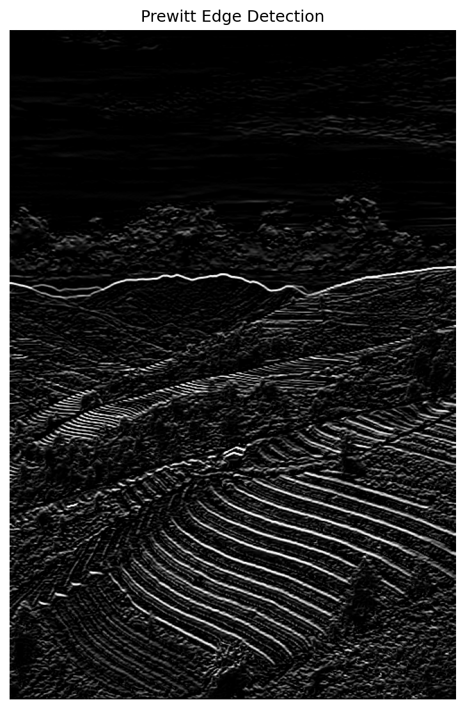
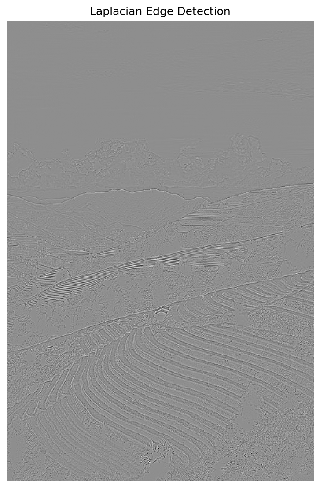
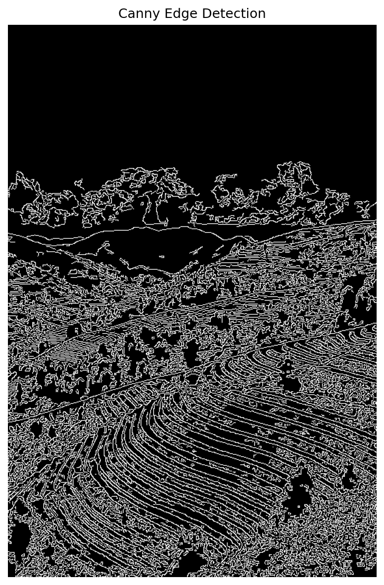

# edge-detection-opencv

## Aim

To perform edge detection using Sobel, Roberts, Prewitt, Laplacian, and Canny edge detectors.

---

## Software Required

- Anaconda – Python 3.7 / Python 3.x  
- Jupyter Notebook / VS Code  
- OpenCV (`cv2`)  
- NumPy  
- Matplotlib  

---

## ⚙️ Algorithm

### Step 1:
Import all the necessary modules for the program.

### Step 2:
Load an image using `cv2.imread()`.

### Step 3:
Convert the image to grayscale.

### Step 4:
Apply **Sobel operator** using OpenCV to detect edges.

### Step 5:
Apply **Prewitt operator** using custom kernels.

### Step 6:
Apply **Roberts operator** using custom kernels.

### Step 7:
Apply **Laplacian operator** using OpenCV.

### Step 8:
Apply **Canny edge detector** using OpenCV.

### Step 9:
Display all edge-detected images for comparison.

---

## Developed By

- **Name:** SUSHMITHA S
- **Register No:** 212224230282

---

## Program

### 1. Original Image
```python
import cv2
import numpy as np
import matplotlib.pyplot as plt

image = cv2.imread('nature.jpeg') 
gray_image = cv2.cvtColor(image, cv2.COLOR_BGR2GRAY)

plt.imshow(cv2.cvtColor(image, cv2.COLOR_BGR2RGB))
plt.title('Original Image')
plt.axis('off')
plt.show()
```

### 2. Sobel Edge Detector
```python
sobel_x = cv2.Sobel(gray_image, cv2.CV_64F, 1, 0, ksize=5)  
sobel_y = cv2.Sobel(gray_image, cv2.CV_64F, 0, 1, ksize=5)  
sobel_combined = cv2.magnitude(sobel_x, sobel_y)  

plt.imshow(sobel_combined, cmap='gray')
plt.title('Sobel Edge Detection')
plt.axis('off')
plt.show()
```

### 3. Prewitt Edge Detector
```python
image = cv2.imread("nature.jpeg")
gray = cv2.cvtColor(image, cv2.COLOR_BGR2GRAY)

prewitt_x = np.array([[-1, 0, -1],
                      [ 1, 0, -1],
                      [ 1, 0, -1]])

prewitt_y = np.array([[ 1,  1,  1],
                      [ 0,  0,  0],
                      [-1, -1, -1]])

prewitt_x_edge = cv2.filter2D(gray, -1, prewitt_x)
prewitt_y_edge = cv2.filter2D(gray, -1, prewitt_y)

prewitt = cv2.magnitude(prewitt_x_edge.astype(np.float32), prewitt_y_edge.astype(np.float32))

plt.imshow(prewitt, cmap='gray')
plt.title('Prewitt Edge Detection')
plt.axis('off')
plt.show()
```

### 4. Roberts Edge Detector
```python
roberts_x = np.array([[1, 0],
                      [0, -1]])

roberts_y = np.array([[0, 1],
                      [-1, 0]])

roberts_x_edge = cv2.filter2D(gray_image, -1, roberts_x)
roberts_y_edge = cv2.filter2D(gray_image, -1, roberts_y)

roberts = cv2.magnitude(roberts_x_edge.astype(np.float32), roberts_y_edge.astype(np.float32))

plt.imshow(roberts, cmap='gray')
plt.title('Roberts Edge Detection')
plt.axis('off')
plt.show()
```

### 5. Laplacian Edge Detector
```python
Laplacian = cv2.Laplacian(gray_image, cv2.CV_64F)

plt.imshow(Laplacian, cmap='gray')
plt.title('Laplacian Edge Detection')
plt.axis('off')
plt.show()
```

### 6. Canny Edge Detector
```python
Canny_edges = cv2.Canny(gray_image, 50, 150)

plt.imshow(Canny_edges, cmap='gray')
plt.title('Canny Edge Detection')
plt.axis('off')
plt.show()
```

---

## Output

### 1. Original Image


---

### 2. Sobel Edge Detector


---

### 3. Prewitt Edge Detector


---

### 4. Roberts Edge Detector


---

### 5. Laplacian Edge Detector


---

### 6. Canny Edge Detector


---

## Result

Thus, edge detection using Sobel, Roberts, Prewitt, Laplacian, and Canny edge detectors was successfully performed and displayed.
